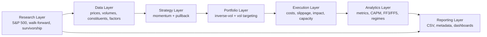
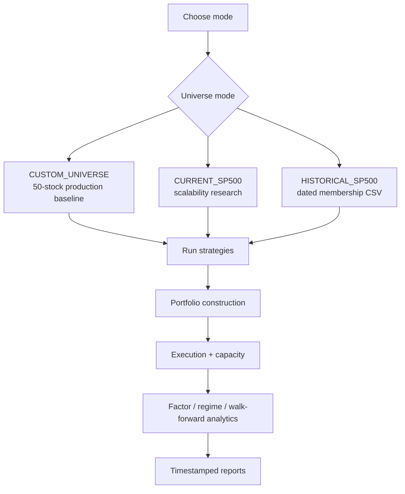
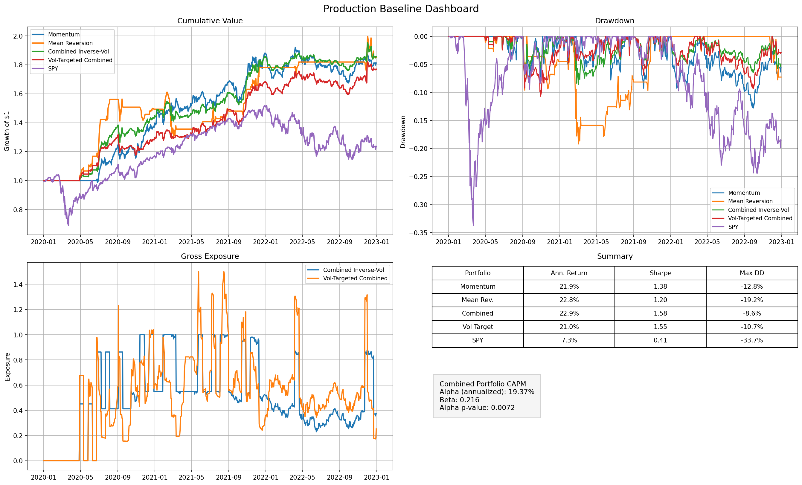
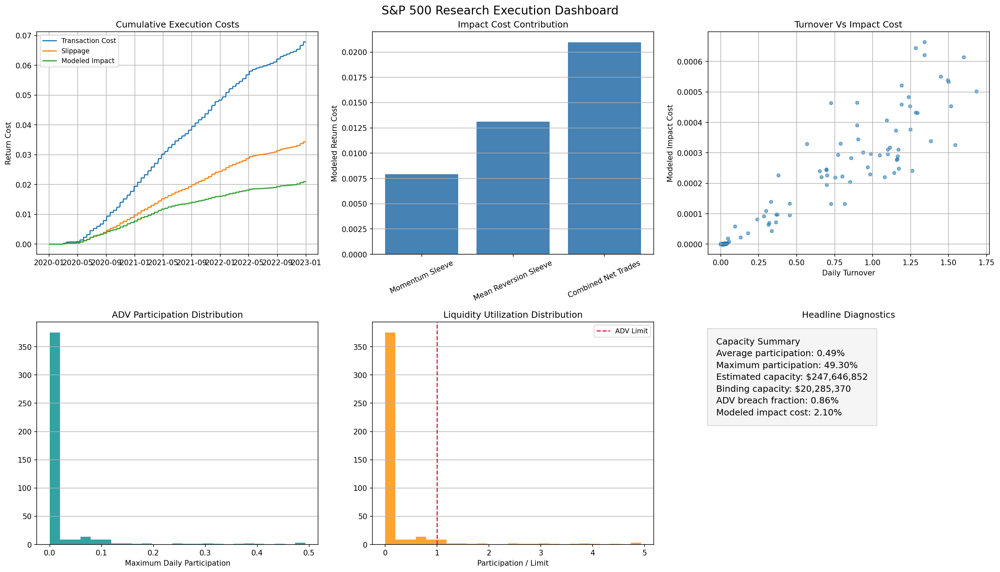
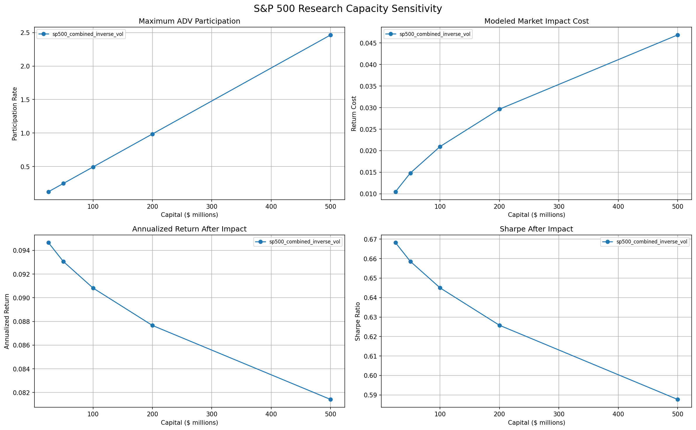
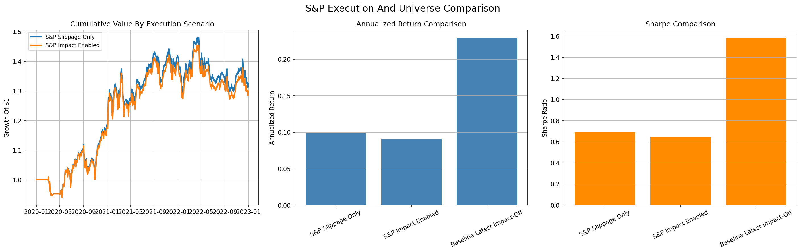
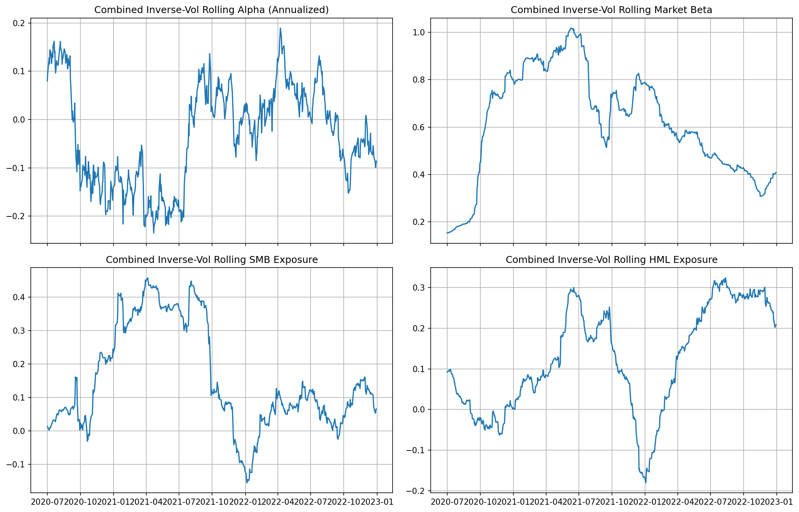
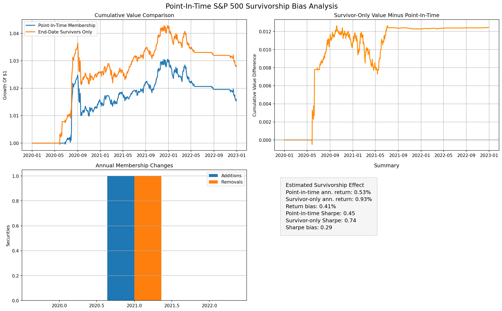

# Systematic Equity Backtesting And Research Platform

Institutional-style Python research platform for systematic U.S. equity strategy testing, portfolio construction, execution realism, factor attribution, walk-forward validation, and point-in-time universe research.

This project is designed as a transparent quantitative research stack: simple auditable signals, realistic portfolio and execution assumptions, reproducible reports, and explicit separation between production-style defaults and research diagnostics.

## Project Overview

The platform evaluates two long-only equity sleeves:

- Momentum: ranks equities by trailing risk-adjusted strength and holds top names.
- Pullback mean reversion: buys controlled short-term pullbacks within longer-term uptrends.

The production portfolio combines sleeves with inverse-volatility weights, applies optional volatility targeting, models transaction costs and slippage, and exports performance, exposure, factor, execution, and robustness reports.

The research layer adds current S&P 500 scaling, optional point-in-time historical membership, market impact and capacity analysis, Fama-French attribution, and selected-versus-fixed walk-forward validation.

## Architecture





## Feature Overview

| Area | Implemented |
| --- | --- |
| Strategy research | Momentum and pullback mean-reversion sleeves |
| Portfolio construction | Inverse-volatility sleeve allocation and volatility targeting |
| Universe support | Fixed 50-stock baseline, current S&P 500, point-in-time membership framework |
| Data quality | Missing-data filter, low-price filter, ticker normalization, batch downloads |
| Liquidity | Lagged average dollar volume eligibility and participation diagnostics |
| Execution realism | Transaction costs, fixed/adaptive slippage, market impact, capacity curves |
| Analytics | Returns, volatility, Sharpe, drawdown, turnover, gross/sector exposure |
| Factor attribution | CAPM, Fama-French 3-factor, optional 5-factor, rolling exposures |
| Robustness | Rolling/expanding walk-forward validation and parameter stability |
| Reporting | Timestamped CSVs, metadata snapshots, dashboards, research plots |

## Sample Dashboards

### Production Performance



### Execution And Capacity





### Execution Scenario Comparison



### Rolling Factor Exposures



### Survivorship Framework Example



## Technical Stack

- Python
- pandas, NumPy
- matplotlib
- yfinance
- statsmodels
- SciPy, optional research optimizer only
- Standard-library HTML/CSV/ZIP handling for S&P 500 and Ken French data retrieval

## Installation

Python 3.10 or newer is recommended.

```powershell
cd Trading-Backtester
python -m venv .venv
.\.venv\Scripts\Activate.ps1
python -m pip install -r requirements.txt
```

The project downloads market data at runtime. Internet access is required for Yahoo Finance, current S&P 500 constituents, and Ken French factor files.

For a short release/run guide, see `RELEASE_CHECKLIST.md`.

## How To Run

```powershell
# Production 50-stock baseline
python run_production_baseline.py

# Backwards-compatible main runner
python run_backtest.py

# Current S&P 500 scalability and execution research
python research\run_sp500_research.py

# Walk-forward out-of-sample validation
python research\run_walk_forward.py

# Historical S&P 500 point-in-time research
$env:HISTORICAL_CONSTITUENTS_FILE = ".\data\historical_sp500_constituents.csv"
python research\run_historical_sp500.py
```

Reports are saved under `reports/<mode>/<timestamp>/`.

## Configuration

Primary settings live in `config/config.py`; mode profiles live in `config/modes.py`.

| Setting | Purpose |
| --- | --- |
| `UNIVERSE_MODE` | `CUSTOM_UNIVERSE`, `CURRENT_SP500`, or `HISTORICAL_SP500` |
| `HISTORICAL_CONSTITUENTS_FILE` | Dated point-in-time membership CSV path |
| `ENABLE_LIQUIDITY_FILTER` | Apply lagged ADV eligibility |
| `MAX_POSITION_WEIGHT` | Optional single-name position cap |
| `SLIPPAGE_MODEL` | `fixed`, `volatility_adjusted`, or `turnover_adjusted` |
| `ENABLE_MARKET_IMPACT` | Deduct modeled market impact from returns |
| `CAPACITY_TARGET_DOLLARS` | Capital assumption for execution realism |
| `ENABLE_FACTOR_ANALYSIS` | Export Ken French factor attribution |
| `VERBOSE_ANALYTICS` | Print detailed console diagnostics |

## Strategy Overview

Momentum sleeve:

- Computes lookback momentum and trailing volatility.
- Scores names by momentum divided by volatility.
- Keeps positive-momentum names only.
- Rebalances on configured intervals.
- Uses the same signal logic in production, S&P 500 research, and walk-forward validation.

Pullback mean-reversion sleeve:

- Requires a longer-term uptrend.
- Selects controlled short-term pullbacks.
- Avoids extreme crash-style moves.
- Rebalances independently from the momentum sleeve.

Production portfolio:

- Combines sleeves using inverse realized volatility.
- Applies optional volatility targeting.
- Preserves fixed production parameters for benchmark validation.

## Execution Realism

Execution assumptions are layered and optional:

1. Transaction costs are charged on turnover.
2. Slippage can be fixed, volatility-adjusted, or turnover-adjusted.
3. Market impact uses trade size, lagged ADV, realized volatility, and participation rate.
4. Capacity analysis estimates deployable capital before ADV participation becomes excessive.

Market impact is disabled by default to preserve the original production return path while still exporting modeled diagnostics.

## Factor Analysis

Factor attribution uses official Kenneth R. French factor files and `statsmodels` OLS.

Supported models:

- CAPM: market excess return
- Fama-French 3-factor: market, SMB, HML
- Optional Fama-French 5-factor: market, SMB, HML, RMW, CMA

Portfolio returns are aligned with realized factor observations. Factors are attribution-only and are not used in signal generation or portfolio construction.

## Walk-Forward Validation

The walk-forward framework supports rolling and expanding windows. It compares:

- Train-selected parameters chosen by in-sample Sharpe.
- Fixed production parameters held constant across windows.

The validation result showed that fixed production parameters were more stable and defensible than noisy window-by-window parameter rotation.

## Survivorship Framework

`data/constituents.py` supports point-in-time historical membership with explicit `entry_date` and optional `exit_date`.

Expected CSV schema:

```csv
ticker,entry_date,exit_date,security,sector,sub_industry,event_reason,source
ABC,2018-06-01,2021-09-30,Example Corp,Industrials,,removed,point_in_time_provider
XYZ,2020-01-15,,Example Holdings,Financials,,added,point_in_time_provider
```

Historical mode:

- Downloads the union of all supplied historical members.
- Applies membership eligibility only between entry and exit dates.
- Forces positions out after supplied exit dates.
- Exports unavailable vendor price histories.
- Compares point-in-time membership against end-date survivor-only membership.

The repository does not ship a licensed historical S&P 500 constituent database. A real survivorship-bias-free study requires an authoritative point-in-time membership source and price data with delisted-security coverage.

## Example Validated Outputs

Validation date: May 28, 2026. Period: configured `2020-01-01` to `2023-01-01`.

| Run | Market Impact | Ann. Return | Volatility | Sharpe | Max DD | FF3 Alpha | Capacity |
| --- | --- | ---: | ---: | ---: | ---: | ---: | ---: |
| Production baseline | OFF | 22.89% | 13.63% | 1.5806 | -8.65% | 19.37% | $1.83B |
| Production baseline | ON | 22.63% | 13.63% | 1.5653 | -8.66% | 19.17% | $1.83B |
| Current S&P 500 research | OFF | 9.83% | 15.26% | 0.6906 | -12.31% | 6.28% | $248.0M |
| Current S&P 500 research | ON | 9.08% | 15.29% | 0.6450 | -12.46% | 5.60% | $247.6M |

Walk-forward validation:

| Path | Impact OFF Avg Test Sharpe | Impact ON Avg Test Sharpe | Positive Test Fraction | Estimated Capacity |
| --- | ---: | ---: | ---: | ---: |
| Selected parameters | 0.8481 | 0.8315 | 66.67% | $2.24B |
| Fixed production parameters | 1.0426 | 1.0265 | 66.67% | $2.58B |

Key interpretation:

- Strongest research result: fixed 50-stock production baseline.
- Most realistic scalable result: current S&P 500 research with market impact ON.
- Execution realism reduced S&P 500 research Sharpe by roughly `0.046`.
- Fixed production parameters outperformed selected parameters on average OOS Sharpe.

## Repository Structure

```text
Trading-Backtester/
|-- analytics/                 # Metrics, drawdowns, regressions, factors, regimes
|-- config/                    # Central settings and named experiment modes
|-- data/                      # Price loading, liquidity, S&P 500, PIT constituents
|-- docs/                      # Project docs and README visual assets
|-- engine/                    # Backtest return and turnover engine
|-- execution/                 # Slippage, market impact, capacity modeling
|-- portfolio/                 # Vol targeting, regime helpers, optional optimizer
|-- reporting/                 # Plotting and report export utilities
|-- research/                  # S&P 500, walk-forward, historical-universe runners
|-- strategies/                # Momentum, mean reversion, position sizing
|-- run_backtest.py            # Main backwards-compatible runner
|-- run_production_baseline.py # Production baseline launcher
|-- requirements.txt
|-- RELEASE_CHECKLIST.md
|-- LICENSE
`-- CONTRIBUTING.md
```

## Report Outputs

Typical report folders contain:

- `summary_metrics.csv`
- `capm_summary.csv`
- `factor_summary.csv`
- `rolling_factor_exposures.csv`
- `execution_costs.csv`
- `capacity_summary.csv`
- `market_impact_analysis.csv`
- `comparison_dashboard.png`
- `execution_dashboard.png`
- `capacity_curves.png`
- `impact_comparison.png`
- `experiment_metadata.json`

Historical-universe runs can additionally export:

- `constituent_history.csv`
- `universe_turnover.csv`
- `annual_membership_changes.csv`
- `survivorship_comparison.csv`
- `unavailable_historical_prices.csv`
- `survivorship_bias_analysis.png`

## Limitations And Assumptions

- Current S&P 500 mode is a current-constituent scalability test, not a survivorship-bias-free historical study.
- Historical S&P 500 mode requires an external point-in-time constituent file.
- Yahoo Finance may not provide complete delisted-security or terminal-event histories.
- Market impact is a stylized ADV/volatility/participation model, not a broker-grade simulator.
- Walk-forward validation currently has limited windows under the default 2020-2023 date range.
- Results are research outputs, not investment advice or live trading recommendations.

## Future Roadmap

- Plug in licensed point-in-time constituent and delisted-return data.
- Add CI tests around report generation and key invariants.
- Add optional command-line arguments for mode/config overrides.
- Add a small sample offline dataset for deterministic demo runs.
- Extend documentation with a methods paper-style writeup.

## Public Release Status

This repository is presentation-ready as a systematic equity research platform. The strongest part of the project is the full research stack: signal generation, portfolio construction, execution realism, factor attribution, walk-forward validation, and reproducible reporting. The main intentionally unfinished piece is true survivorship-bias-free benchmarking, which depends on data that should be sourced from a point-in-time constituent and delisted-security vendor rather than fabricated inside the repository.
